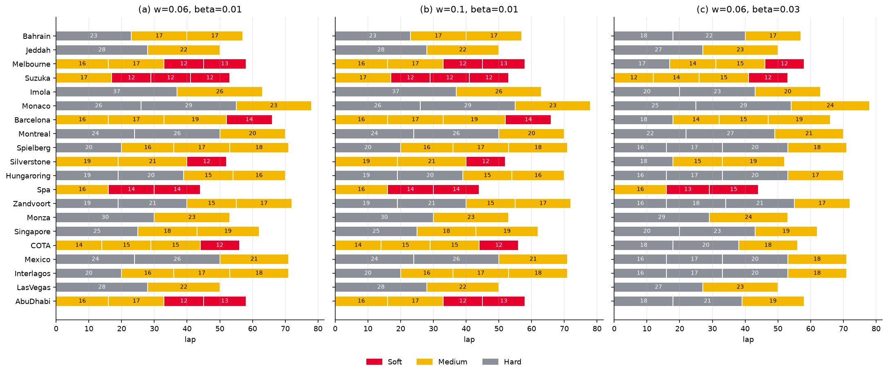
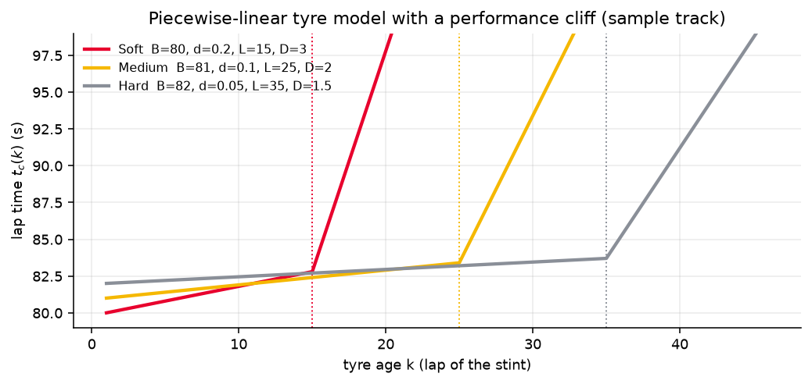
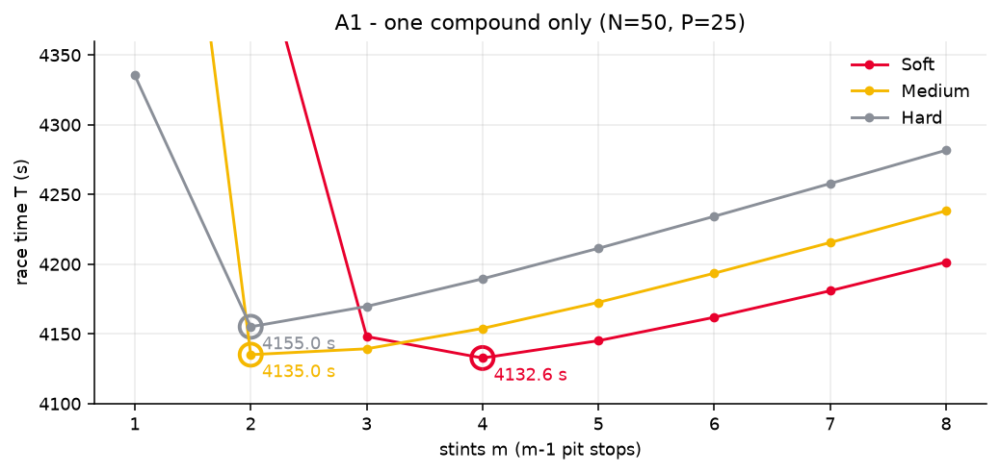
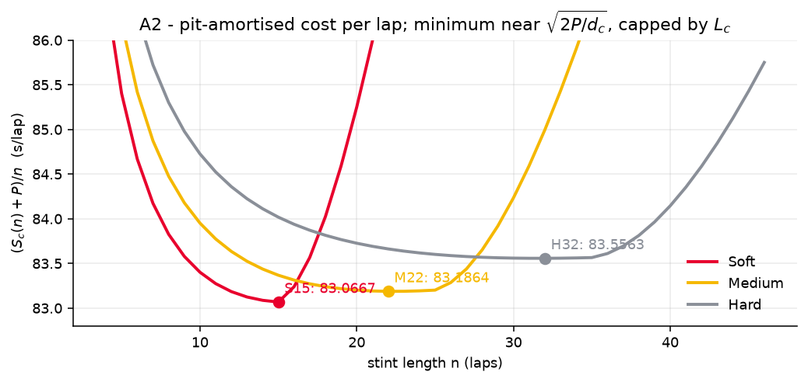
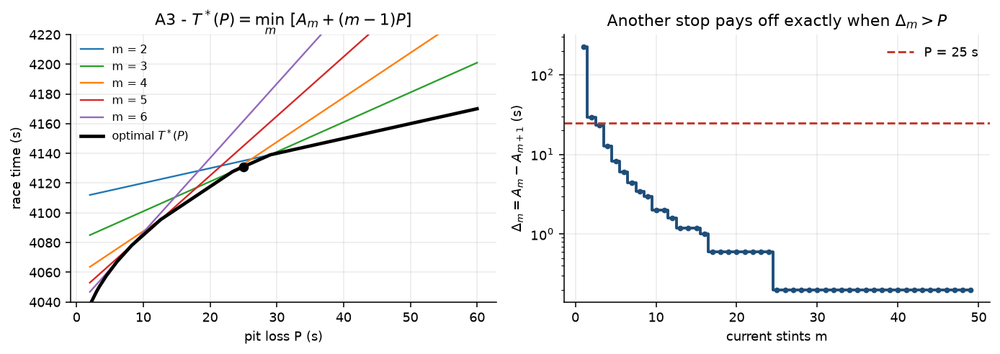
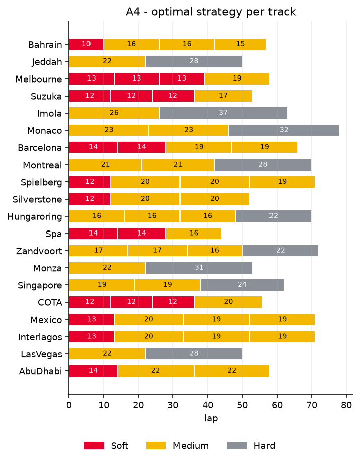
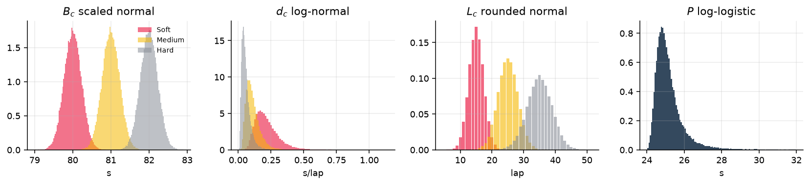
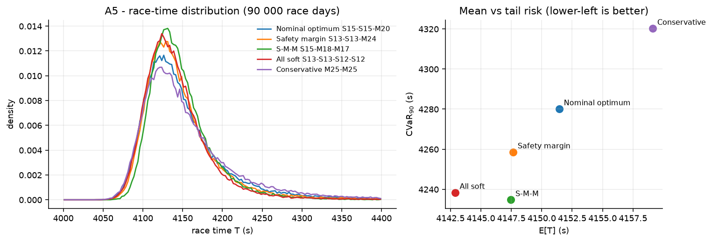
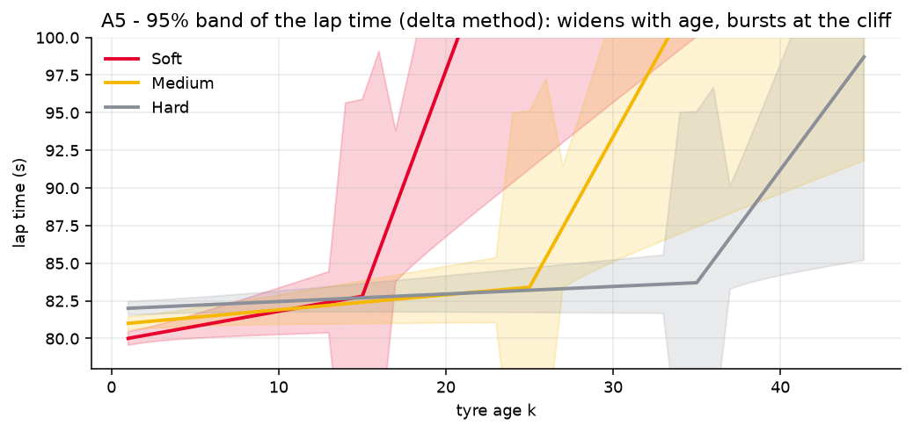
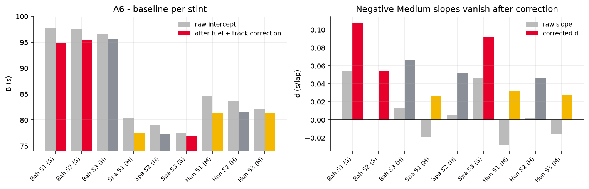

<div align="center">

# 🏎️ VM2C 2026 · F1 Pit-Stop & Tyre Strategy

**Open-source reproduction of team 2026024's solution to the Vietnam Math Modeling Competition 2026, Round 2**
*“Chiến thuật Pit Stop trong Đua xe Công thức 1”: when to pit, which tyre to fit, and how fuel and uncertainty change the answer*

[](https://github.com/KenPTNK/vm2c-f1-tyre-strategy/actions/workflows/tests.yml)


**English** · [Tiếng Việt](README.vi.md) · Papers: [Part A (EN)](papers/part-a-en.pdf) · [Part B (EN)](papers/part-b-en.pdf) · [Phần A (VI)](papers/phan-a-vi.pdf) · [Phần B (VI)](papers/phan-b-vi.pdf)



</div>

---

## Contents

- [What this is](#what-this-is)
- [Quick start](#quick-start)
- [Every published number, re-computed](#every-published-number-re-computed)
- [The model in one page](#the-model-in-one-page)
- [Part A: tyre strategy](#part-a-tyre-strategy)
  - [A1 · one compound](#a1--one-compound) · [A2 · mixing compounds](#a2--mixing-compounds) · [A3 · pit-loss thresholds](#a3--how-the-pit-loss-p-changes-the-plan) · [A4 · 20 tracks](#a4--20-real-tracks) · [A5 · uncertainty & robustness](#a5--uncertainty-monte-carlo-and-a-robust-strategy) · [A6 · real-race calibration](#a6--calibrating-on-real-races-fastf1)
- [Part B: fuel load](#part-b-fuel-load)
- [Using the library](#using-the-library)
- [Repository layout](#repository-layout)
- [Notes on the reproduction](#notes-on-the-reproduction)
- [Team, citation, licence](#team)

## What this is

In a dry Formula 1 race a team picks tyre compounds (**S**oft, **M**edium, **H**ard), how many laps each set runs (a **stint**), and therefore how many pit stops to make. Softer tyres are faster but wear quicker and hit a **performance cliff** sooner; every stop costs `P` seconds.

The two papers (Part A and Part B) solve this with hand-derived lemmas: marginal-cost balance, a penalty function, a sorting theorem. They contain almost no code. **This repository rebuilds all of it as a small, tested Python package**:

| | What the papers do | What the code does |
|---|---|---|
| **A1–A3** | closed forms for stint time, optimal stint length $\sqrt{2P/d}$, a step function of stints against `P` | the same formulas, plus the full threshold table |
| **A4** | penalty function + greedy trim/extend over 20 tracks | the paper's heuristic **and** an exact optimiser that proves it right |
| **A5** | correlated parameter noise, 90 000-race Monte Carlo, VaR/CVaR, Pareto analysis | vectorised Monte Carlo, risk metrics, delta-method bands |
| **A6** | FastF1 extraction, fuel and track-evolution correction, OLS, broken-stick fit | the extraction script + the full correction pipeline |
| **B1–B3** | fuel model, decomposition identity, sorting theorem, 20 tracks × 3 settings, improved model | exact order-aware optimiser, decomposition, sorting theorem, B3 model |

One command regenerates every table (`results/*.csv`) and figure (`figures/*.png`), and **51 tests check the numbers printed in the papers**.

## Quick start

```bash
git clone https://github.com/KenPTNK/vm2c-f1-tyre-strategy.git
cd vm2c-f1-tyre-strategy
pip install -e .[dev]          # numpy + matplotlib (+ pytest)

python -m vm2c                 # reproduce every table and figure (~15 s)
pytest -q                      # 51 checks against the published numbers
```

Optional, for downloading real lap data in A6: `pip install -e .[a6]` (FastF1 + pandas).

## Every published number, re-computed

| Paper result | Paper | This code |
|---|---|---|
| A1 best single-compound plan | Soft 13-13-12-12, **4132.60 s** | `S13+S13+S12+S12`, 4132.60 s ✅ |
| A2 optimum on the sample track | S15 + S15 + M20, **4131 s** | 4131.00 s ✅ |
| A3 marginal savings $\Delta_m$ and the 16-row threshold table | 225.25, 29, 23.4, 12.6, … | identical ✅ |
| A4 totals and “margin to next structure”, 20 tracks | e.g. Bahrain **5592.375 s**, margin 0.4075 s | 20/20 identical ✅ |
| A5 risk table (E[T], σ, CVaR₉₀) | S-M-M lowest σ & CVaR, all-soft lowest mean | same ranking; values within Monte Carlo noise ✅ |
| A6 calibration: $E_r$, $B^{ref}$, $d$, lower bounds on $L$ | $E_{Hun}=0.419$, $E_{Bah}=-0.711$, $L_S\gtrsim22$ … | identical (one slope 0.031 vs 0.034, [see notes](#notes-on-the-reproduction)) ✅ |
| B1(c) sample track with fuel | **M20 + S15 + S15, 4219.92 s** | identical ✅ |
| B2 20 tracks × (a), (b), (c) | e.g. Bahrain H23+M17+M17 5705.39 / 5771.51, H18+H22+M17 5728.07 | 60/60 strategies and times identical ✅ |
| Theorem B.4: (b) − (a) $=0.04\,N(N+1)/2$ | proved | checked on all 20 tracks ✅ |

## The model in one page

**Lap time** of the $k$-th lap on a tyre set of compound $c$ (Part A):

$$
t_c(k)=\begin{cases}B_c+d_c(k-1), & k\le L_c\\ B_c+d_c(L_c-1)+D_c(k-L_c), & k>L_c\end{cases}
$$

$B_c$ base pace, $d_c$ wear before the cliff, $L_c$ cliff lap, $D_c\gg d_c$ wear after it.



**Stint time** (closed form, `Tyre.stint`):

$$
S_c(n)=\begin{cases}nB_c+\tfrac{d_c}{2}n(n-1), & n\le L_c\\ nB_c+\tfrac{d_c}{2}(L_c-1)(2n-L_c)+\tfrac{D_c}{2}(n-L_c)(n-L_c+1), & n>L_c\end{cases}
$$

**Race time** of a strategy $(c_1,n_1),\dots,(c_m,n_m)$ with $\sum n_i=N$:

$$
T=\sum_{i=1}^{m}S_{c_i}(n_i)+(m-1)P .
$$

**Part B** adds fuel, $F(\ell)=N-\ell+1$ on global lap $\ell$:

$$
t_c(k,\ell)=B_c+wF(\ell)+g_c(k)\bigl(1+\beta F(\ell)\bigr),\qquad g_c(k)=t_c(k)-B_c .
$$

**Exact optimiser.** `vm2c.solver.optimise` is a dynamic programme over *(laps driven, compounds used)* that accepts any lap-time function `lap(c, k, l)`. It is exact for the order-dependent fuel model too, and it is the ground truth every hand derivation is tested against.

## Part A: tyre strategy

Sample track: $N=50$, $P=25$; S $(80, 0.2, 15, 3)$, M $(81, 0.1, 25, 2)$, H $(82, 0.05, 35, 1.5)$ for $(B,d,L,D)$.

### A1 · one compound

Amortising one pit over each stint, the average lap cost is $\bar t_c(n)=B_c+\tfrac{d_c}{2}(n-1)+\tfrac{P}{n}$, minimised at

$$
n_c^*=\sqrt{2P/d_c},\qquad m_c^*=N\sqrt{d_c/2P},\qquad \bar t_c^*=B_c-\tfrac{d_c}{2}+\sqrt{2Pd_c}.
$$

If $n_c^*>L_c$ the cliff binds. Stints of one compound should differ by at most one lap (moving a lap from a long to a short stint changes time by $t_c(n_j+1)-t_c(n_i)\le0$).

| Compound | $n^*$ | best plan | $T$ (s) |
|---|---|---|---|
| Soft | 15.81 (> L = 15, cliff binds) | 13-13-12-12 (3 stops) | **4132.6** |
| Medium | 22.36 | 25-25 (1 stop) | 4135.0 |
| Hard | 31.62 | 25-25 (1 stop) | 4155.0 |



### A2 · mixing compounds

**Lemma (marginal-cost balance).** At the optimum, $\max_i t_{c_i}(n_i)\le\min_j t_{c_j}(n_j+1)$: no stint's last lap may cost more than one extra lap added to another stint. The cheapest units are Soft ≈ 15 laps (83.0667 s/lap), then Medium 22 (83.1864) and Hard 32 (83.5563). Building on S15 stints gives

$$
\boxed{S15+S15+M20,\quad T=4131\ \text{s}}
$$



### A3 · how the pit loss P changes the plan

With $A_m$ the least running time using exactly $m$ stints, $T_m(P)=A_m+(m-1)P$, and a further stop pays off iff $\Delta_m=A_m-A_{m+1}>P$. The optimal number of stints is a **non-increasing step function of $P$** (exchange argument: $(m_2-m_1)(P_2-P_1)\le0$).

| P range (s) | stints | plan | $T^*(P)$ |
|---|---|---|---|
| 8.2 – 12.6 | 5 | 5 × S10 | 4045.0 + 4P |
| 12.6 – 23.4 | 4 | 2 × S13 + 2 × S12 | 4057.6 + 3P |
| **23.4 – 29.0** | **3** | **2 × S15 + M20** | **4081.0 + 2P** |
| 29.0 – 225.25 | 2 | 2 × M25 | 4110.0 + P |
| > 225.25 | 1 | H50 | 4335.25 |

The full 16-row table (down to 50 × S1 for $P<0.2$) is in [`results/a3_thresholds.csv`](results/a3_thresholds.csv).



### A4 · 20 real tracks

Rule: at least two compounds. The paper turns time into **penalty against an ideal stint**:

$$
\lambda=\min_{c,n}\frac{S_c(n)+P}{n},\qquad p_c(n)=S_c(n)+P-n\lambda\ \ge 0,\qquad T=N\lambda-P+\sum_i p_{c_i}(n_i).
$$

Take $x$ copies of the ideal stint $C_L$ and $y$ of the cheapest stint on another compound $C_A$, then trim (or extend) laps greedily. Removing lap $r$ costs $\lambda-t_c(r)$, which is monotone within a stint, so the greedy choice is optimal (prefix-constraint exchange argument).

| # | Track | Optimal plan | Pit after lap | Total (s) | Margin (s) |
|---|---|---|---|---|---|
| 1 | Bahrain | S10 + M16 + M16 + M15 | 10, 26, 42 | 5592.3750 | 0.4075 |
| 2 | Jeddah | M22 + H28 | 22 | 4603.5000 | 1.5000 |
| 3 | Melbourne | S13 + S13 + S13 + M19 | 13, 26, 39 | 4715.2950 | 1.1850 |
| 4 | Suzuka | S12 + S12 + S12 + M17 | 12, 24, 36 | 4919.5000 | 3.0000 |
| 5 | Imola | M26 + H37 | 26 | 4949.5100 | 2.4450 |
| 6 | Monaco | M23 + M23 + H32 | 23, 46 | 5769.7800 | 1.8500 |
| 7 | Barcelona | S14 + S14 + M19 + M19 | 14, 28, 47 | 5190.8600 | 0.1000 |
| 8 | Montreal | M21 + M21 + H28 | 21, 42 | 5274.6550 | 1.8775 |
| 9 | Spielberg | S12 + M20 + M20 + M19 | 12, 32, 52 | 4807.1600 | 2.0400 |
| 10 | Silverstone | S12 + M20 + M20 | 12, 32 | 4733.4400 | 4.4800 |
| 11 | Hungaroring | M16 + M16 + M16 + H22 | 16, 32, 48 | 5581.5925 | 0.3375 |
| 12 | Spa | S14 + S14 + M16 | 14, 28 | 4686.0000 | 6.2000 |
| 13 | Zandvoort | M17 + M17 + M16 + H22 | 17, 34, 50 | 5303.7750 | 1.7750 |
| 14 | Monza | M22 + H31 | 22 | 4339.3720 | 2.8840 |
| 15 | Singapore | M19 + M19 + H24 | 19, 38 | 6079.2000 | 3.5200 |
| 16 | COTA | S12 + S12 + S12 + M20 | 12, 24, 36 | 5536.2500 | 0.5500 |
| 17 | Mexico | S13 + M20 + M19 + M19 | 13, 33, 52 | 5716.8400 | 0.5750 |
| 18 | Interlagos | S13 + M20 + M19 + M19 | 13, 33, 52 | 5238.5200 | 2.1250 |
| 19 | Las Vegas | M22 + H28 | 22 | 4802.5000 | 0.5000 |
| 20 | Abu Dhabi | S14 + M22 + M22 | 14, 36 | 5248.8200 | 0.4750 |

*Margin = gap to the best plan using a different set of compounds. In Part A the order of stints does not matter, so any order of the same stints is equally fast.*



### A5 · uncertainty, Monte Carlo and a robust strategy

Parameters are uncertain and **correlated through one race-day factor** $\xi\sim N(0,1)$ (a hot day wears every compound faster and brings every cliff earlier), plus independent per-compound noise of equal weight:

| Parameter | Distribution | Why |
|---|---|---|
| $B_c=B_c^0\,(1+a_{B_c}(\xi+\nu_c))$ | scaled normal | symmetric, sum of many small effects, multiplicative |
| $d_c=d_c^0e^{a_{d_c}(\xi+\varepsilon_c)}$, $D_c=\max(D_c^0e^{a_{D_c}(\xi+\varepsilon_c')},3d_c)$ | log-normal | positive, right-skewed; the cliff stays a cliff |
| $L_c=\mathrm{round}(L_c^0(1-0.1\xi)+1.8\zeta_c)$ | rounded normal | integer; a hot day brings the cliff earlier |
| $P=24+(U/(1-U))^{1/3}$ per stop | log-logistic | a physical floor plus a heavy right tail (Heilmeier et al. 2020) |

The coefficients are calibrated from the posterior intervals of Cappello & Hoegh (2025): $\mathrm{CoV}_d\approx0.42/0.49/0.60$ and $\sigma_B\approx0.23$ s.



Five candidate strategies, each the structural minimiser of one criterion, are scored on 90 000 simulated race days (`results/a5_risk.csv`):

| Strategy | E[T] (s) | σ (s) | CVaR₉₀ (s) |
|---|---|---|---|
| Nominal optimum S15·S15·M20 | 4151.4 | 57.5 | 4280.1 |
| Safety margin S13·S13·M24 | 4147.7 | 50.5 | 4258.6 |
| **S-M-M S15·M18·M17** | 4147.5 | **40.3** | **4234.8** |
| All soft S13·S13·S12·S12 | **4142.9** | 45.2 | 4238.4 |
| Conservative M25·M25 | 4159.1 | 71.9 | 4320.3 |

**Takeaways.** (1) No plan wins every column: this is a Pareto trade-off. (2) **S-M-M** gives up 0.11 % of mean time for about 11 % less spread and the lightest tail: the recommended robust plan. (3) Backing off 1–2 laps from the cliff dominates the nominal optimum, as the **safety-margin theorem** predicts: $\varphi(n)=\mathbb E[(n-L)^+]$ is convex with $\varphi(n)-\varphi(n-1)=F_L(n-1)$. (4) Fewer stops is not safer: M25·M25 parks both stints on the cliff.




### A6 · calibrating on real races (FastF1)

Three 2023 wins by Max Verstappen (Bahrain, Spain, Hungary): one driver and clean air, two stops each, every compound seen three times. The observation model separates tyre wear from fuel and track evolution:

$$
y=B^{ref}_{r,c}+d_c(k-1)+\underbrace{\varphi_r(N_r-\ell)}_{F_r(\ell),\ \varphi_r=3/(N_r-1)}+\underbrace{E_re^{-(\ell-1)/10}}_{H_r(\ell)}+\varepsilon .
$$

$E_r$ is identified only from two same-compound stints in one race: Hungary gives $+0.419$ s (used), Bahrain gives $-0.711$ s (rejected because a negative track penalty has no meaning), and Spain has no pair. After correction **the negative Medium slopes vanish**, Soft wears fastest ($\bar d_S=0.085$, $\bar d_M=0.029$, $\bar d_H=0.055$ s/lap), and no stint shows a clear cliff, so only lower bounds remain: $L_S\gtrsim22$, $L_M\gtrsim26$, $L_H\gtrsim28$. A `broken_stick` fit (scan $\kappa$, minimum RSS) is included for data that does pass the cliff.



## Part B: fuel load

**Decomposition (Proposition B.1).** Every lap $\ell=1..N$ is driven exactly once, so

$$
T_B=T_A+\underbrace{w\,\tfrac{N(N+1)}{2}}_{\text{same for every plan}}+\beta\,\Phi,\qquad \Phi=\sum_i\sum_k g_{c_i}(k)\,F(\ell).
$$

- **$w$ never changes the optimal strategy.** Going from (a) $w=0.06$ to (b) $w=0.10$ adds exactly $0.04\,N(N+1)/2$ s to every track (Theorem B.4).
- **Sorting theorem (B.2).** For adjacent stints, $\Phi(A,B)-\Phi(B,A)=n_BG_A-n_AG_B$, so the best order runs stints by **increasing mean wear** $\bar g=G/n$: the gentlest tyre goes first, while the car is heaviest. On the sample track the A2 plan flips to **M20 + S15 + S15 = 4219.92 s** (it would be 4222.62 s in the Part A order).
- Raising $\beta$ from 0.01 to 0.03 pushes Hard tyres to the front and splits early stints: across the 20 tracks Hard stints go from 18 to 35, Soft stints from 12 to 4, and 14 tracks change their compound sequence.

| Track | (a) = (b) plan | T (a) | T (b) | (c) plan | T (c) |
|---|---|---|---|---|---|
| Bahrain | H23+M17+M17 | 5705.39 | 5771.51 | H18+H22+M17 | 5728.07 |
| Monaco | H26+H29+M23 | 5969.70 | 6092.94 | H25+H29+M24 | 5995.64 |
| Spa | M16+S14+S14 | 4753.81 | 4793.41 | M16+S13+S15 | 4770.28 |
| … | | | | | |

All 20 × 3 results are in [`results/b2_a.csv`](results/b2_a.csv), [`b2_b.csv`](results/b2_b.csv) and [`b2_c.csv`](results/b2_c.csv), in the same format as A4. The chart at the top of this page shows all three settings.

**B3 · improved model.** Per-compound fuel sensitivities $w_c,\beta_c$, a smooth (softplus) cliff, and a cold-tyre out-lap penalty:

$$
t_c^{new}(k,\ell)=B_c+w_cF(\ell)+\Bigl[d_c(k-1)+A_c\ln\bigl(1+e^{\lambda_c(k-L_c)}\bigr)\Bigr]\bigl(1+\beta_cF(\ell)\bigr)+u_ce^{-\rho_c(k-1)}
$$

This is implemented as `model.lap_time_b3` and solved exactly by the same optimiser. The paper gives no values for the new parameters, so `results/b3_demo.csv` uses **illustrative** ones.

## Using the library

```python
from vm2c import SAMPLE, load_tracks, optimise
from vm2c.model import lap_time_a, lap_time_b
from vm2c import part_a, part_b, robust

# A2: best plan on the sample track
best = optimise(SAMPLE.N, SAMPLE.P, lap_time_a(SAMPLE), min_compounds=1)
print(best, best.total, best.pit_laps)        # S15+S15+M20 4131.0 [15, 30]

# A4: one track, with the paper's heuristic and the runner-up structure
monza = {t.name: t for t in load_tracks()}["Monza"]
print(part_a.penalty_heuristic(monza), part_a.structures(monza)[:2])

# B: fuel model, decomposition and the sorting theorem
plan = part_b.solve(SAMPLE, w=0.06, beta=0.01)  # M20+S15+S15, 4219.92 s
print(part_b.decompose(SAMPLE, plan.stints, 0.06, 0.01))

# A5: risk profile of any plan
T = robust.simulate((("S", 15), ("M", 18), ("M", 17)), n=90_000)
print(robust.risk(T))                           # mean, std, VaR90, CVaR90

# Any custom lap-time model: lap(compound, tyre_age, global_lap) -> seconds
my_lap = lambda c, k, l: SAMPLE.tyres[c].lap(k) + 0.01 * (50 - l)
print(optimise(50, 25.0, my_lap))
```

**A6 with fresh data.** `python -m vm2c.calibration` runs the paper's FastF1 extraction and writes `data/fastf1/VER_2023_<GP>_clean.csv`; then `calibration.fit_laps(path, N, E)` fits each stint lap by lap. Since 2026 the F1 live-timing server answers `401` without a login, so FastF1 will ask for an F1 account.

## Repository layout

```
vm2c/
  model.py        lap-time models (A, B, B3), closed-form stint time, track loader
  solver.py       exact DP optimiser for any lap-time function
  part_a.py       A1 closed forms · A2 envelope/economy · A3 thresholds · A4 penalty heuristic
  robust.py       A5 correlated sampling, Monte Carlo, VaR/CVaR, delta-method band
  calibration.py  A6 FastF1 extraction, fuel/track correction, OLS, E_r, broken-stick
  part_b.py       B1 decomposition, sorting theorem, B2 solver
  figures.py      every figure in this README
  __main__.py     `python -m vm2c`: reproduce all results
data/
  tracks.csv      the 20-track table (problem appendix A, VM2C 2026 organisers)
  a6_stints.csv   per-stint raw fits of the three 2023 races (from the paper)
results/          generated tables (CSV)
figures/          generated figures (PNG)
papers/           the team's papers, English and Vietnamese
tests/            51 checks against the papers
```

## Notes on the reproduction

- **A4 heuristic, literal against widened.** Run exactly as written ($m\in\{\lfloor N/n_0\rfloor,\lceil N/n_0\rceil\}$, $x\ge y$, only the cheapest second compound), the penalty heuristic finds the optimum on 16 of 20 tracks; it misses Monaco, Montreal, COTA and Las Vegas by 0.5–9.3 s. The paper's “then compare against all” step, implemented as `widened=True` (also $m\pm1$, $x<y$, both other compounds), finds all 20. The exact optimiser confirms every row.
- **A5** uses a fresh random stream, so values move by a few tenths of a second against the paper; the ranking and conclusions are identical, and the tests allow for this noise.
- **A6** lap-level data cannot be re-downloaded without an F1 account, so the pipeline runs from the per-stint raw fits printed in the paper. Every corrected value matches except Hungary stint 1, where $d$ is 0.031 against the paper's 0.034, because the paper fitted lap by lap.
- **B1(b)** in the submitted paper sketches a per-stint closed form for $n$. The code instead uses the exact optimiser, which reproduces every B1/B2 result.

<a id="team"></a>
## Team, citation, licence

**Team 2026024 · Second Prize, VM²C 2026:** Phạm Hiến Minh, Nguyễn Khắc Trung Kiên, Phan Tấn Phát, Đoàn Văn Quyết.
The competition is organised by [VIASM](https://viasm.edu.vn) and IEG Foundation. The problem statement and the 20-track data belong to the organisers.

```bibtex
@misc{vm2c2026team024,
  title  = {Pit-Stop and Tyre Strategy in Formula 1: Round 2 solution, Vietnam Math Modeling Competition 2026},
  author = {Pham, Hien Minh and Nguyen, Khac Trung Kien and Phan, Tan Phat and Doan, Van Quyet},
  year   = {2026},
  note   = {Team 2026024. Code: https://github.com/KenPTNK/vm2c-f1-tyre-strategy}
}
```

**References.** C. Cappello, A. Hoegh (2025), *A State-Space Approach to Modeling Tire Degradation in Formula 1 Racing*, arXiv:2512.00640 · A. Heilmeier, M. Graf, J. Betz, M. Lienkamp (2020), *Application of Monte Carlo Methods to Consider Probabilistic Effects in a Race Simulation for Circuit Motorsport*, Applied Sciences 10(12):4229 · T. Phillips (2014), log-logistic pit-stop model · [FastF1](https://github.com/theOehrly/Fast-F1).

Code released under the [MIT licence](LICENSE).
