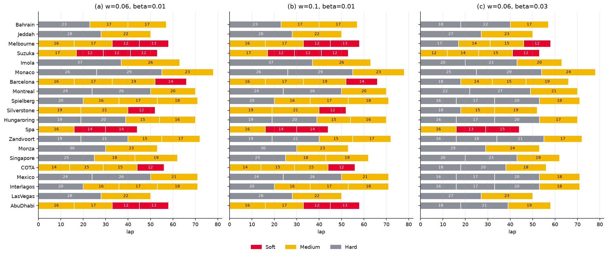
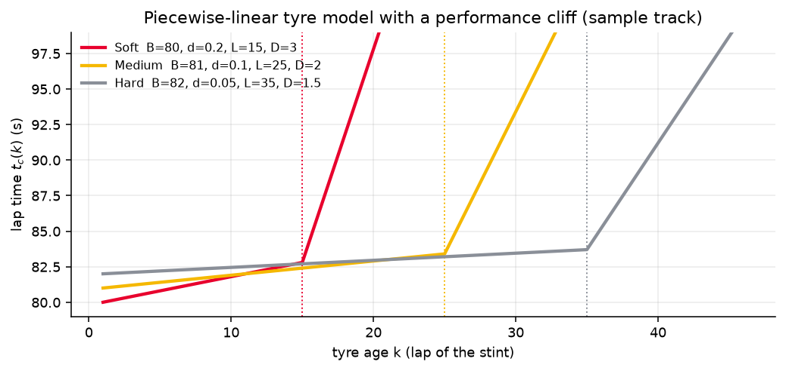
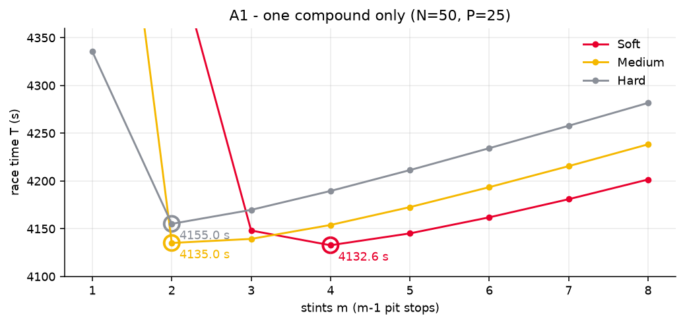
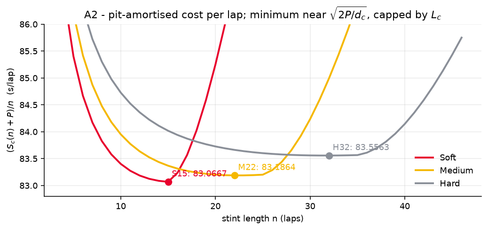
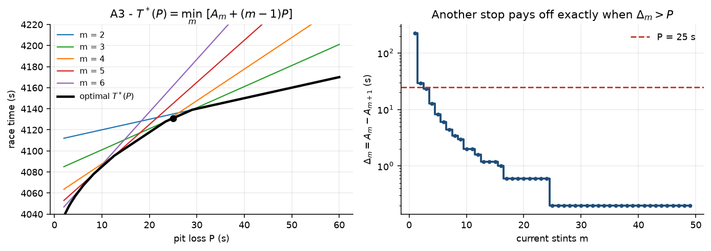
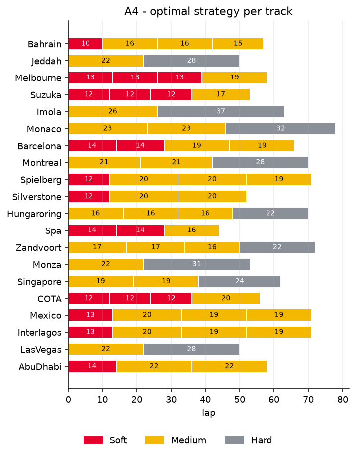
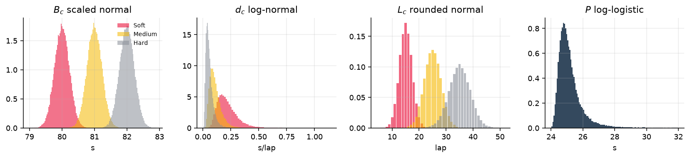
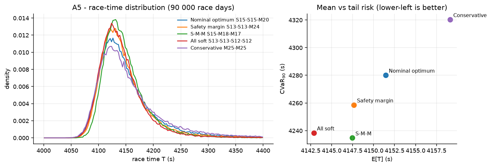
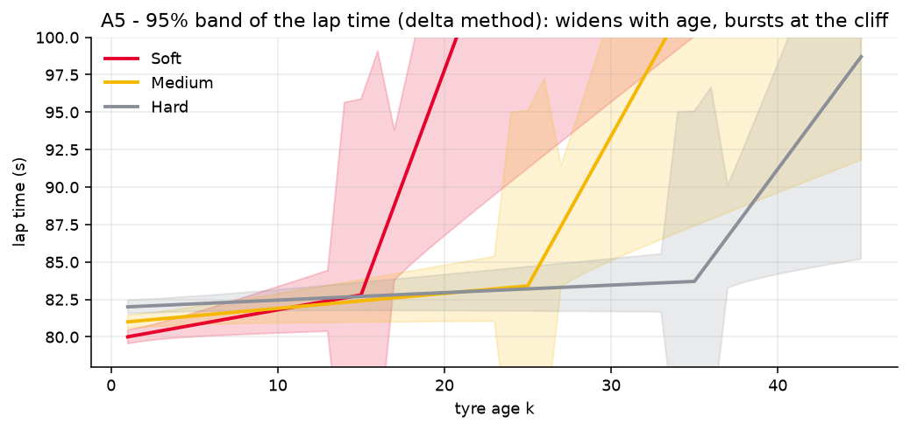
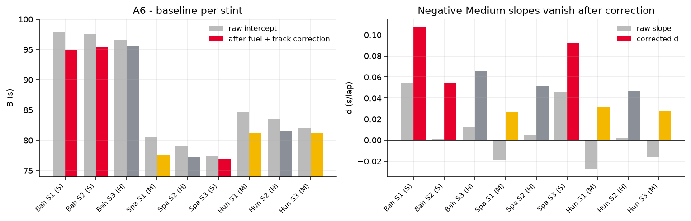

<div align="center">

# 🏎️ VM2C 2026 · Chiến thuật Pit Stop & Lốp trong F1

**Mã nguồn mở tái hiện lời giải của đội 2026024, Vòng 2 Kỳ thi Mô hình hóa Toán học Việt Nam 2026**
*Khi nào vào pit, thay lốp gì, và nhiên liệu cùng sự bất định làm thay đổi lời giải ra sao*

[](https://github.com/KenPTNK/vm2c-f1-tyre-strategy/actions/workflows/tests.yml)


[English](README.md) · **Tiếng Việt** · Bài báo: [Phần A (VI)](papers/phan-a-vi.pdf) · [Phần B (VI)](papers/phan-b-vi.pdf) · [Part A (EN)](papers/part-a-en.pdf) · [Part B (EN)](papers/part-b-en.pdf)



</div>

---

## Mục lục

- [Đây là gì](#đây-là-gì)
- [Chạy nhanh](#chạy-nhanh)
- [Kiểm chứng mọi con số trong bài](#kiểm-chứng-mọi-con-số-trong-bài)
- [Mô hình gói gọn](#mô-hình-gói-gọn)
- [Phần A: chiến thuật lốp](#phần-a-chiến-thuật-lốp)
- [Phần B: nhiên liệu](#phần-b-nhiên-liệu)
- [Dùng thư viện](#dùng-thư-viện)
- [Cấu trúc repo](#cấu-trúc-repo)
- [Ghi chú về việc tái hiện](#ghi-chú-về-việc-tái-hiện)
- [Đội thi, trích dẫn, giấy phép](#đội-thi)

## Đây là gì

Trong một chặng F1 trời khô, đội đua chọn loại lốp (**S**oft, **M**edium, **H**ard), mỗi bộ chạy bao nhiêu vòng (một **stint**), và từ đó số lần vào pit. Lốp càng mềm càng nhanh nhưng mòn càng nhanh và chạm **điểm gãy hiệu năng** (cliff) càng sớm; mỗi lần pit mất `P` giây.

Hai bài báo (Phần A và Phần B) giải bài toán bằng các bổ đề tự chứng minh: cân bằng chi phí biên, hàm phạt, định lý sắp xếp. Trong bài gần như không có code. **Repo này dựng lại toàn bộ thành một gói Python nhỏ, có kiểm thử**:

| | Bài báo làm gì | Code làm gì |
|---|---|---|
| **A1–A3** | công thức đóng cho thời gian stint, độ dài tối ưu $\sqrt{2P/d}$, hàm bậc thang của số stint theo `P` | đúng các công thức đó, kèm bảng ngưỡng đầy đủ |
| **A4** | hàm phạt + tham lam rút/thêm vòng cho 20 đường đua | thuật toán của bài **và** bộ tối ưu chính xác để kiểm chứng |
| **A5** | nhiễu tham số có tương quan, Monte Carlo 90 000 lần, VaR/CVaR, Pareto | Monte Carlo vector hóa, chỉ số rủi ro, dải delta-method |
| **A6** | trích dữ liệu FastF1, hiệu chỉnh nhiên liệu và mặt đường, OLS, broken-stick | script trích dữ liệu + toàn bộ pipeline hiệu chỉnh |
| **B1–B3** | mô hình nhiên liệu, đẳng thức tách, định lý sắp xếp, 20 đường × 3 bộ, mô hình cải tiến | bộ tối ưu chính xác có tính thứ tự, đẳng thức tách, định lý sắp xếp, mô hình B3 |

Một lệnh sinh lại mọi bảng (`results/*.csv`) và hình (`figures/*.png`); **51 test kiểm các con số in trong bài**.

## Chạy nhanh

```bash
git clone https://github.com/KenPTNK/vm2c-f1-tyre-strategy.git
cd vm2c-f1-tyre-strategy
pip install -e .[dev]          # numpy + matplotlib (+ pytest)

python -m vm2c                 # tái hiện mọi bảng và hình (~15 giây)
pytest -q                      # 51 phép kiểm so với số liệu trong bài
```

Tùy chọn cho A6 (tải dữ liệu vòng đua thật): `pip install -e .[a6]` (FastF1 + pandas).

## Kiểm chứng mọi con số trong bài

| Kết quả | Trong bài | Code |
|---|---|---|
| A1 chiến thuật một loại lốp tốt nhất | Soft 13-13-12-12, **4132,60 s** | `S13+S13+S12+S12`, 4132,60 s ✅ |
| A2 nghiệm trên đường đua mẫu | S15 + S15 + M20, **4131 s** | 4131,00 s ✅ |
| A3 dãy $\Delta_m$ và bảng ngưỡng 16 dòng | 225,25; 29; 23,4; 12,6; … | trùng khớp ✅ |
| A4 tổng thời gian và “cách biệt”, 20 đường đua | vd. Bahrain **5592,375 s**, cách biệt 0,4075 s | 20/20 trùng khớp ✅ |
| A5 bảng rủi ro (E[T], σ, CVaR₉₀) | S-M-M có σ và CVaR nhỏ nhất, toàn Mềm có kỳ vọng nhỏ nhất | cùng thứ hạng; sai khác trong mức nhiễu Monte Carlo ✅ |
| A6 hiệu chỉnh: $E_r$, $B^{ref}$, $d$, cận dưới của $L$ | $E_{Hun}=0{,}419$, $E_{Bah}=-0{,}711$, $L_S\gtrsim22$ … | trùng khớp (một slope 0,031 so với 0,034, [xem ghi chú](#ghi-chú-về-việc-tái-hiện)) ✅ |
| B1(c) đường mẫu có nhiên liệu | **M20 + S15 + S15, 4219,92 s** | trùng khớp ✅ |
| B2 20 đường × bộ (a), (b), (c) | vd. Bahrain H23+M17+M17 5705,39 / 5771,51; H18+H22+M17 5728,07 | 60/60 chiến thuật và thời gian trùng khớp ✅ |
| Định lý B.4: (b) − (a) $=0{,}04\,N(N+1)/2$ | đã chứng minh | kiểm trên cả 20 đường ✅ |

## Mô hình gói gọn

**Thời gian vòng** thứ $k$ của một bộ lốp loại $c$ (Phần A):

$$
t_c(k)=\begin{cases}B_c+d_c(k-1), & k\le L_c\\ B_c+d_c(L_c-1)+D_c(k-L_c), & k>L_c\end{cases}
$$

$B_c$ là nhịp cơ sở, $d_c$ tốc độ mòn trước điểm gãy, $L_c$ điểm gãy, $D_c\gg d_c$ tốc độ mòn sau điểm gãy.



**Thời gian một stint** (công thức đóng, `Tyre.stint`):

$$
S_c(n)=\begin{cases}nB_c+\tfrac{d_c}{2}n(n-1), & n\le L_c\\ nB_c+\tfrac{d_c}{2}(L_c-1)(2n-L_c)+\tfrac{D_c}{2}(n-L_c)(n-L_c+1), & n>L_c\end{cases}
$$

**Tổng thời gian đua** của chiến thuật $(c_1,n_1),\dots,(c_m,n_m)$ với $\sum n_i=N$: $\;T=\sum_i S_{c_i}(n_i)+(m-1)P$.

**Phần B** thêm nhiên liệu $F(\ell)=N-\ell+1$ ở vòng toàn cục $\ell$:

$$
t_c(k,\ell)=B_c+wF(\ell)+g_c(k)\bigl(1+\beta F(\ell)\bigr),\qquad g_c(k)=t_c(k)-B_c .
$$

**Bộ tối ưu chính xác.** `vm2c.solver.optimise` là quy hoạch động trên trạng thái *(số vòng đã chạy, các loại lốp đã dùng)*, nhận mọi hàm thời gian vòng `lap(c, k, l)`. Nó chính xác cả với mô hình nhiên liệu (phụ thuộc thứ tự stint) và là “đáp án chuẩn” để kiểm mọi lập luận tay trong bài.

## Phần A: chiến thuật lốp

Đường mẫu: $N=50$, $P=25$; S $(80;\ 0{,}2;\ 15;\ 3)$, M $(81;\ 0{,}1;\ 25;\ 2)$, H $(82;\ 0{,}05;\ 35;\ 1{,}5)$ cho $(B,d,L,D)$.

### A1 · một loại lốp

Khấu hao một lần pit vào mỗi stint: $\bar t_c(n)=B_c+\tfrac{d_c}{2}(n-1)+\tfrac{P}{n}$, cực tiểu tại

$$
n_c^*=\sqrt{2P/d_c},\qquad m_c^*=N\sqrt{d_c/2P},\qquad \bar t_c^*=B_c-\tfrac{d_c}{2}+\sqrt{2Pd_c}.
$$

Nếu $n_c^*>L_c$ thì điểm gãy “khóa” nghiệm. Các stint cùng loại lốp chỉ nên chênh nhau tối đa 1 vòng.

| Lốp | $n^*$ | Chiến thuật tốt nhất | $T$ (s) |
|---|---|---|---|
| Soft | 15,81 (> L = 15, điểm gãy khóa) | 13-13-12-12 (3 pit) | **4132,6** |
| Medium | 22,36 | 25-25 (1 pit) | 4135,0 |
| Hard | 31,62 | 25-25 (1 pit) | 4155,0 |



### A2 · phối nhiều loại lốp

**Bổ đề cân bằng chi phí biên:** ở nghiệm tối ưu, $\max_i t_{c_i}(n_i)\le\min_j t_{c_j}(n_j+1)$. Đơn vị chạy rẻ nhất là Soft khoảng 15 vòng (83,0667 s/vòng), rồi đến Medium 22 vòng (83,1864) và Hard 32 vòng (83,5563). Lấy S15 làm xương sống, ta được $\boxed{S15+S15+M20,\ T=4131\text{ s}}$.



### A3 · thời gian pit P thay đổi chiến thuật thế nào

Gọi $A_m$ là thời gian chạy nhỏ nhất với đúng $m$ stint, khi đó $T_m(P)=A_m+(m-1)P$; thêm một lần pit có lợi khi và chỉ khi $\Delta_m=A_m-A_{m+1}>P$. Số stint tối ưu là **hàm bậc thang không tăng theo $P$**.

| Khoảng P (s) | Số stint | Chiến thuật | $T^*(P)$ |
|---|---|---|---|
| 8,2 – 12,6 | 5 | 5 × S10 | 4045,0 + 4P |
| 12,6 – 23,4 | 4 | 2 × S13 + 2 × S12 | 4057,6 + 3P |
| **23,4 – 29,0** | **3** | **2 × S15 + M20** | **4081,0 + 2P** |
| 29,0 – 225,25 | 2 | 2 × M25 | 4110,0 + P |
| > 225,25 | 1 | H50 | 4335,25 |

Bảng đầy đủ 16 dòng ở [`results/a3_thresholds.csv`](results/a3_thresholds.csv).



### A4 · 20 đường đua

Luật: dùng ít nhất 2 loại lốp. Bài báo đổi thời gian thành **độ phạt so với stint lý tưởng**:

$$
\lambda=\min_{c,n}\frac{S_c(n)+P}{n},\qquad p_c(n)=S_c(n)+P-n\lambda\ \ge 0,\qquad T=N\lambda-P+\sum_i p_{c_i}(n_i).
$$

Lấy $x$ stint lý tưởng nhất $C_L$ và $y$ stint lý tưởng nhì $C_A$ (khác loại lốp), rồi rút (hoặc thêm) vòng theo kiểu tham lam: bỏ vòng thứ $r$ tốn $\lambda-t_c(r)$, đơn điệu trong từng stint, nên tham lam là tối ưu.

| # | Đường đua | Chiến thuật tối ưu | Pit sau vòng | Tổng (s) | Cách biệt (s) |
|---|---|---|---|---|---|
| 1 | Bahrain | S10 + M16 + M16 + M15 | 10, 26, 42 | 5592,3750 | 0,4075 |
| 2 | Jeddah | M22 + H28 | 22 | 4603,5000 | 1,5000 |
| 3 | Melbourne | S13 + S13 + S13 + M19 | 13, 26, 39 | 4715,2950 | 1,1850 |
| 4 | Suzuka | S12 + S12 + S12 + M17 | 12, 24, 36 | 4919,5000 | 3,0000 |
| 5 | Imola | M26 + H37 | 26 | 4949,5100 | 2,4450 |
| 6 | Monaco | M23 + M23 + H32 | 23, 46 | 5769,7800 | 1,8500 |
| 7 | Barcelona | S14 + S14 + M19 + M19 | 14, 28, 47 | 5190,8600 | 0,1000 |
| 8 | Montreal | M21 + M21 + H28 | 21, 42 | 5274,6550 | 1,8775 |
| 9 | Spielberg | S12 + M20 + M20 + M19 | 12, 32, 52 | 4807,1600 | 2,0400 |
| 10 | Silverstone | S12 + M20 + M20 | 12, 32 | 4733,4400 | 4,4800 |
| 11 | Hungaroring | M16 + M16 + M16 + H22 | 16, 32, 48 | 5581,5925 | 0,3375 |
| 12 | Spa | S14 + S14 + M16 | 14, 28 | 4686,0000 | 6,2000 |
| 13 | Zandvoort | M17 + M17 + M16 + H22 | 17, 34, 50 | 5303,7750 | 1,7750 |
| 14 | Monza | M22 + H31 | 22 | 4339,3720 | 2,8840 |
| 15 | Singapore | M19 + M19 + H24 | 19, 38 | 6079,2000 | 3,5200 |
| 16 | COTA | S12 + S12 + S12 + M20 | 12, 24, 36 | 5536,2500 | 0,5500 |
| 17 | Mexico | S13 + M20 + M19 + M19 | 13, 33, 52 | 5716,8400 | 0,5750 |
| 18 | Interlagos | S13 + M20 + M19 + M19 | 13, 33, 52 | 5238,5200 | 2,1250 |
| 19 | Las Vegas | M22 + H28 | 22 | 4802,5000 | 0,5000 |
| 20 | Abu Dhabi | S14 + M22 + M22 | 14, 36 | 5248,8200 | 0,4750 |

*Cách biệt = chênh lệch với chiến thuật tốt nhất dùng tổ hợp lốp khác. Ở Phần A thứ tự stint không ảnh hưởng tổng thời gian.*



### A5 · bất định, Monte Carlo và chiến thuật bền vững

Tham số không chắc chắn và **tương quan qua một nhiễu chung của ngày đua** $\xi\sim N(0,1)$ (ngày nóng làm mọi loại lốp mòn nhanh hơn và gãy sớm hơn), cộng thêm nhiễu riêng từng loại lốp với mức ảnh hưởng ngang nhau:

| Tham số | Phân phối | Lý do |
|---|---|---|
| $B_c=B_c^0\,(1+a_{B_c}(\xi+\nu_c))$ | chuẩn-tỷ-lệ | đối xứng, tổng nhiều nhiễu nhỏ, tác động nhân |
| $d_c=d_c^0e^{a_{d_c}(\xi+\varepsilon_c)}$, $D_c=\max(D_c^0e^{a_{D_c}(\xi+\varepsilon_c')},3d_c)$ | log-chuẩn | dương, lệch phải; vẫn giữ bản chất “vách đá” |
| $L_c=\mathrm{round}(L_c^0(1-0{,}1\xi)+1{,}8\zeta_c)$ | chuẩn-làm-tròn | số nguyên; ngày nóng gãy sớm |
| $P=24+(U/(1-U))^{1/3}$ cho từng lần pit | log-logistic | có sàn vật lý và đuôi phải nặng |

Các hệ số được hiệu chỉnh theo khoảng tin cậy posterior của Cappello & Hoegh (2025).



Năm chiến thuật ứng viên, mỗi cái là cực tiểu cấu trúc của một tiêu chí, được chấm trên 90 000 “ngày đua” (`results/a5_risk.csv`):

| Chiến thuật | E[T] (s) | σ (s) | CVaR₉₀ (s) |
|---|---|---|---|
| Tối ưu danh nghĩa S15·S15·M20 | 4151,4 | 57,5 | 4280,1 |
| Biên an toàn S13·S13·M24 | 4147,7 | 50,5 | 4258,6 |
| **S-M-M S15·M18·M17** | 4147,5 | **40,3** | **4234,8** |
| Toàn Mềm S13·S13·S12·S12 | **4142,9** | 45,2 | 4238,4 |
| Bảo thủ M25·M25 | 4159,1 | 71,9 | 4320,3 |

**Kết luận.** (1) Không chiến thuật nào thắng cả ba cột: đây là đánh đổi Pareto. (2) **S-M-M** chỉ chậm hơn 0,11 % về kỳ vọng nhưng giảm khoảng 11 % độ lệch và có đuôi nhẹ nhất: đây là chiến thuật bền vững được khuyến nghị. (3) Lùi 1–2 vòng trước điểm gãy luôn tốt hơn nghiệm danh nghĩa, đúng như **định lý biên an toàn**: $\varphi(n)=\mathbb E[(n-L)^+]$ lồi, với $\varphi(n)-\varphi(n-1)=F_L(n-1)$. (4) Ít pit chưa chắc an toàn: M25·M25 đặt cả hai stint đúng điểm gãy.




### A6 · hiệu chỉnh trên dữ liệu đua thật (FastF1)

Dùng ba chặng Max Verstappen thắng năm 2023 (Bahrain, Tây Ban Nha, Hungary): cùng tay đua, không khí sạch, đều 2 pit, mỗi loại lốp xuất hiện 3 lần. Mô hình quan sát tách mòn lốp khỏi nhiên liệu và mặt đường:

$$
y=B^{ref}_{r,c}+d_c(k-1)+\underbrace{\varphi_r(N_r-\ell)}_{F_r(\ell),\ \varphi_r=3/(N_r-1)}+\underbrace{E_re^{-(\ell-1)/10}}_{H_r(\ell)}+\varepsilon .
$$

$E_r$ chỉ xác định được khi một chặng có hai stint cùng loại lốp: Hungary cho $+0{,}419$ s (dùng), Bahrain cho $-0{,}711$ s (loại vì phạt mặt đường âm là vô lý), Tây Ban Nha không có cặp nào. Sau hiệu chỉnh, **slope âm của lốp Medium biến mất**, Soft mòn nhanh nhất ($\bar d_S=0{,}085$; $\bar d_M=0{,}029$; $\bar d_H=0{,}055$ s/vòng). Không stint nào thấy rõ điểm gãy, nên chỉ có cận dưới: $L_S\gtrsim22$, $L_M\gtrsim26$, $L_H\gtrsim28$. Repo có sẵn hàm `broken_stick` (quét $\kappa$, chọn RSS nhỏ nhất) cho dữ liệu có đoạn sau điểm gãy.



## Phần B: nhiên liệu

**Đẳng thức tách (Mệnh đề B.1).** Mỗi vòng $\ell=1..N$ được chạy đúng một lần, nên

$$
T_B=T_A+\underbrace{w\,\tfrac{N(N+1)}{2}}_{\text{như nhau với mọi chiến thuật}}+\beta\,\Phi,\qquad \Phi=\sum_i\sum_k g_{c_i}(k)\,F(\ell).
$$

- **$w$ không bao giờ đổi chiến thuật tối ưu.** Từ bộ (a) $w=0{,}06$ sang (b) $w=0{,}10$, mọi đường đua cộng thêm đúng $0{,}04\,N(N+1)/2$ giây (Định lý B.4).
- **Định lý sắp xếp (B.2).** Với hai stint kề nhau, $\Phi(A,B)-\Phi(B,A)=n_BG_A-n_AG_B$, nên thứ tự tối ưu là **mòn trung bình $\bar g=G/n$ tăng dần**: lốp mòn nhẹ chạy trước, lúc xe nặng nhất. Trên đường mẫu, nghiệm A2 bị đảo thành **M20 + S15 + S15 = 4219,92 s** (nếu giữ thứ tự Phần A thì là 4222,62 s).
- Tăng $\beta$ từ 0,01 lên 0,03 đẩy lốp Hard lên đầu và chia nhỏ các stint sớm: trên 20 đường, số stint Hard tăng từ 18 lên 35, Soft giảm từ 12 xuống 4, và 14 đường đổi hẳn chuỗi lốp.

Toàn bộ 20 × 3 kết quả nằm trong [`results/b2_a.csv`](results/b2_a.csv), [`b2_b.csv`](results/b2_b.csv) và [`b2_c.csv`](results/b2_c.csv), cùng định dạng với A4. Hình ở đầu trang thể hiện cả ba bộ tham số.

**B3 · mô hình cải tiến.** Dùng $w_c,\beta_c$ riêng cho từng loại lốp, thay điểm gãy gãy khúc bằng hàm mượt (softplus), và thêm hiệu ứng lốp lạnh sau pit:

$$
t_c^{mới}(k,\ell)=B_c+w_cF(\ell)+\Bigl[d_c(k-1)+A_c\ln\bigl(1+e^{\lambda_c(k-L_c)}\bigr)\Bigr]\bigl(1+\beta_cF(\ell)\bigr)+u_ce^{-\rho_c(k-1)}
$$

Mô hình này được cài trong `model.lap_time_b3` và giải chính xác bằng cùng bộ tối ưu. Bài báo không cho giá trị các tham số mới, nên `results/b3_demo.csv` dùng giá trị **minh họa**.

## Dùng thư viện

```python
from vm2c import SAMPLE, load_tracks, optimise
from vm2c.model import lap_time_a, lap_time_b
from vm2c import part_a, part_b, robust

best = optimise(SAMPLE.N, SAMPLE.P, lap_time_a(SAMPLE), min_compounds=1)
print(best, best.total, best.pit_laps)          # S15+S15+M20 4131.0 [15, 30]

monza = {t.name: t for t in load_tracks()}["Monza"]
print(part_a.penalty_heuristic(monza), part_a.structures(monza)[:2])

plan = part_b.solve(SAMPLE, w=0.06, beta=0.01)  # M20+S15+S15, 4219.92 s
print(part_b.decompose(SAMPLE, plan.stints, 0.06, 0.01))

T = robust.simulate((("S", 15), ("M", 18), ("M", 17)), n=90_000)
print(robust.risk(T))                           # mean, std, VaR90, CVaR90

# Mô hình tùy ý: lap(loại lốp, tuổi lốp, vòng toàn cục) -> giây
my_lap = lambda c, k, l: SAMPLE.tyres[c].lap(k) + 0.01 * (50 - l)
print(optimise(50, 25.0, my_lap))
```

**A6 với dữ liệu mới.** `python -m vm2c.calibration` chạy đoạn code FastF1 trong bài và ghi ra `data/fastf1/VER_2023_<GP>_clean.csv`; sau đó `calibration.fit_laps(path, N, E)` fit từng stint theo từng vòng. Từ năm 2026 máy chủ live-timing của F1 trả lỗi `401` nếu chưa đăng nhập, nên FastF1 sẽ hỏi tài khoản F1.

## Cấu trúc repo

```
vm2c/
  model.py        mô hình thời gian vòng (A, B, B3), công thức đóng S_c(n), đọc dữ liệu
  solver.py       bộ tối ưu quy hoạch động chính xác cho mọi hàm thời gian vòng
  part_a.py       A1 công thức đóng · A2 đường bao · A3 ngưỡng P · A4 thuật toán hàm phạt
  robust.py       A5 lấy mẫu có tương quan, Monte Carlo, VaR/CVaR, dải delta-method
  calibration.py  A6 FastF1, hiệu chỉnh nhiên liệu/mặt đường, OLS, E_r, broken-stick
  part_b.py       B1 đẳng thức tách, định lý sắp xếp, giải B2
  figures.py      mọi hình trong README
  __main__.py     `python -m vm2c`: tái hiện toàn bộ kết quả
data/
  tracks.csv      bảng 20 đường đua (Phụ lục A của đề, BTC VM2C 2026)
  a6_stints.csv   kết quả fit thô từng stint của 3 chặng 2023 (lấy từ bài)
results/          bảng kết quả (CSV)
figures/          hình (PNG)
papers/           bài báo của đội, bản tiếng Anh và tiếng Việt
tests/            51 phép kiểm so với bài báo
```

## Ghi chú về việc tái hiện

- **A4: thuật toán đúng nguyên văn so với bản nới rộng.** Chạy đúng như mô tả ($m\in\{\lfloor N/n_0\rfloor,\lceil N/n_0\rceil\}$, $x\ge y$, chỉ lấy lốp lý tưởng nhì rẻ nhất), thuật toán hàm phạt tìm đúng nghiệm ở 16/20 đường; trượt Monaco, Montreal, COTA và Las Vegas 0,5–9,3 s. Bước “so sánh lại với tất cả” của bài, cài thành `widened=True` (thêm $m\pm1$, $x<y$, cả hai loại lốp còn lại), tìm đúng cả 20. Bộ tối ưu chính xác xác nhận mọi dòng.
- **A5** dùng chuỗi số ngẫu nhiên mới nên các giá trị lệch vài phần mười giây so với bài; thứ hạng và kết luận giữ nguyên, và test có tính đến mức nhiễu này.
- **A6**: dữ liệu từng vòng không tải lại được nếu không có tài khoản F1, nên pipeline chạy từ kết quả fit thô từng stint in trong bài. Mọi giá trị hiệu chỉnh đều khớp, trừ stint 1 ở Hungary: $d$ ra 0,031 so với 0,034 trong bài, vì bài fit trên từng vòng.
- **B1(b)**: bài nộp phác thảo một công thức đóng cho $n$ theo từng stint. Code dùng bộ tối ưu chính xác thay thế, và tái hiện đúng mọi kết quả B1/B2.

<a id="đội-thi"></a>
## Đội thi, trích dẫn, giấy phép

**Đội 2026024, VM²C 2026:** Phạm Hiến Minh, Nguyễn Khắc Trung Kiên, Phan Tấn Phát, Đoàn Văn Quyết.
Kỳ thi do [VIASM](https://viasm.edu.vn) và IEG Foundation tổ chức. Đề bài và dữ liệu 20 đường đua thuộc về Ban Tổ chức.

Trích dẫn (BibTeX) và tài liệu tham khảo: xem [README tiếng Anh](README.md#team).

Mã nguồn phát hành theo [giấy phép MIT](LICENSE).
